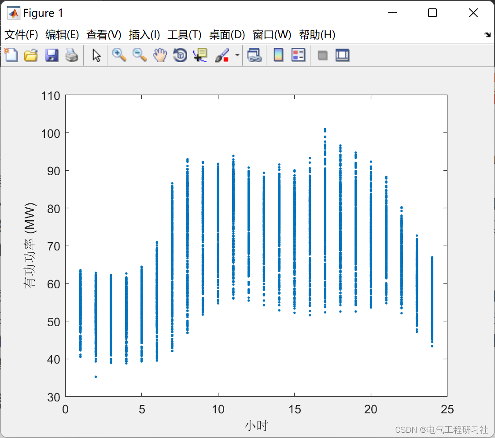
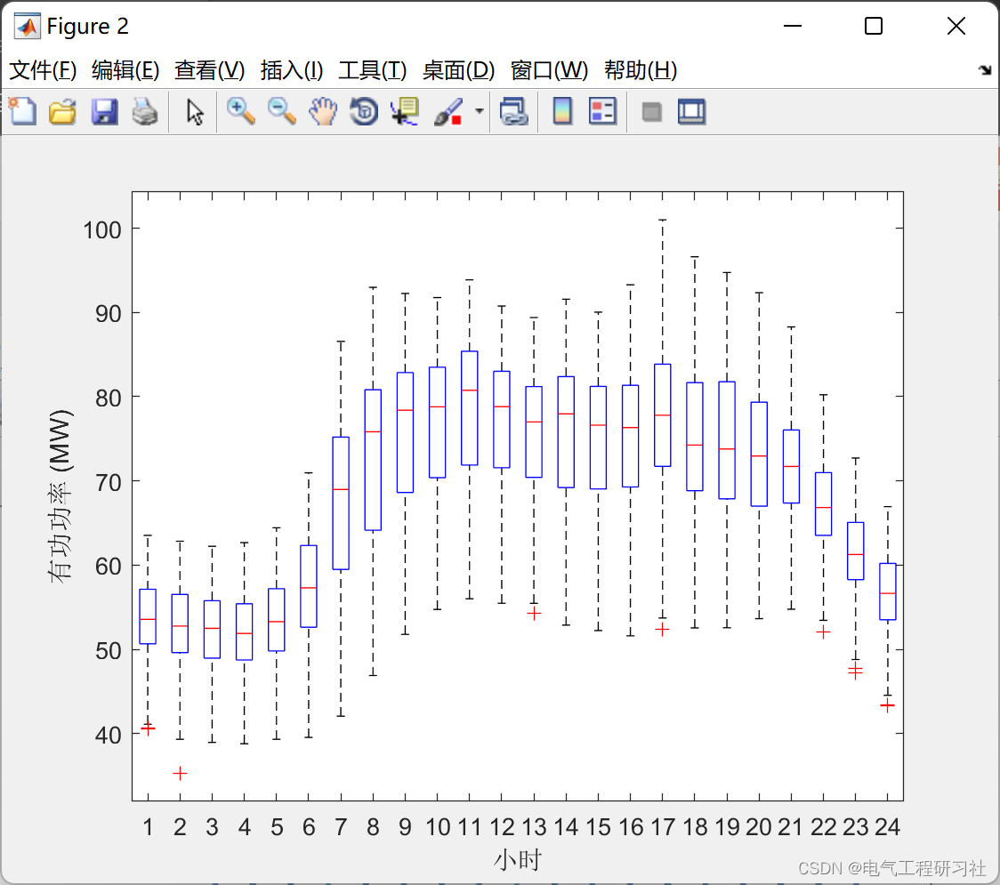
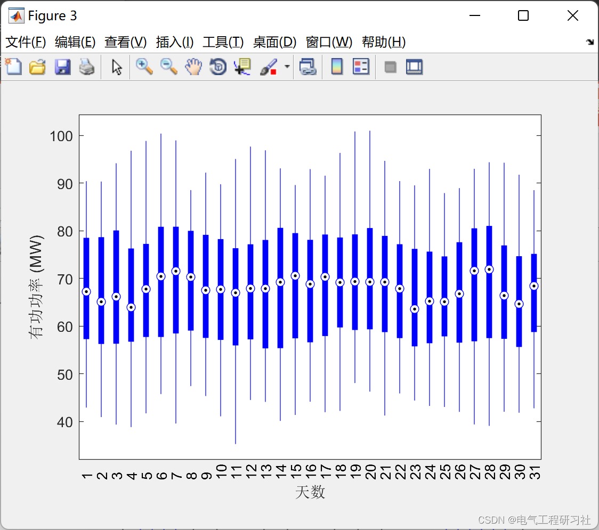
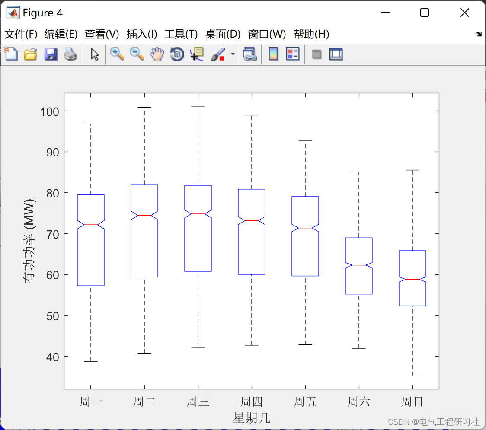
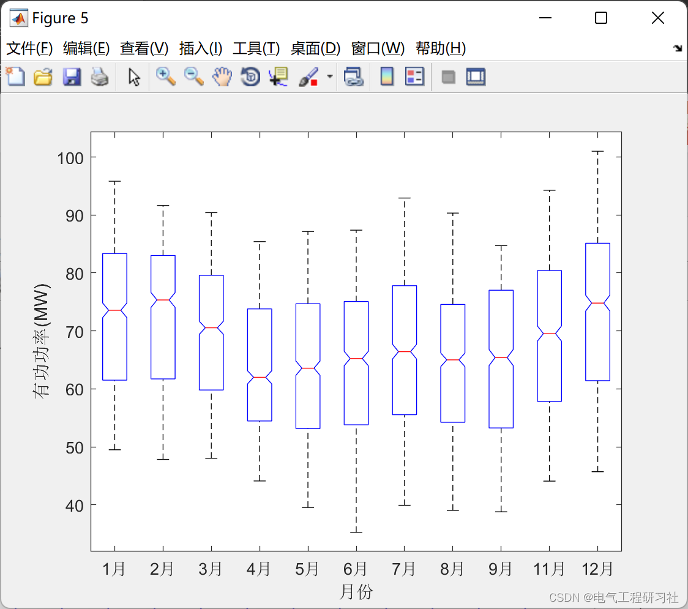
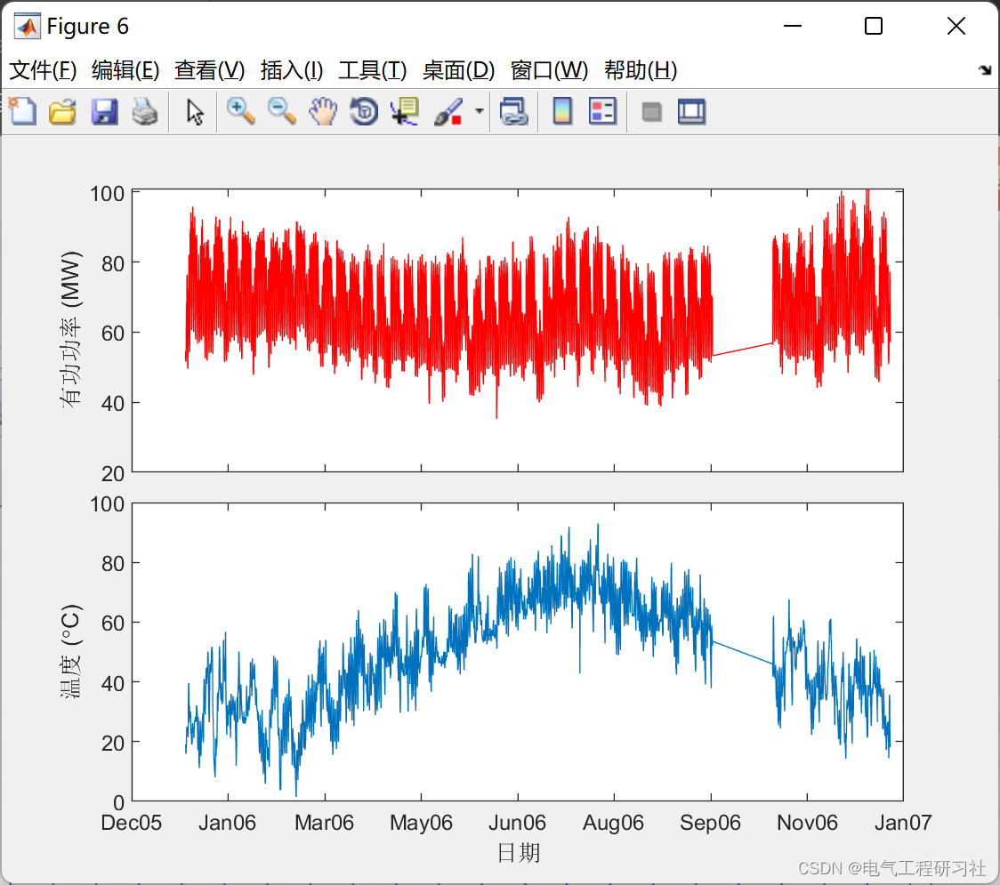
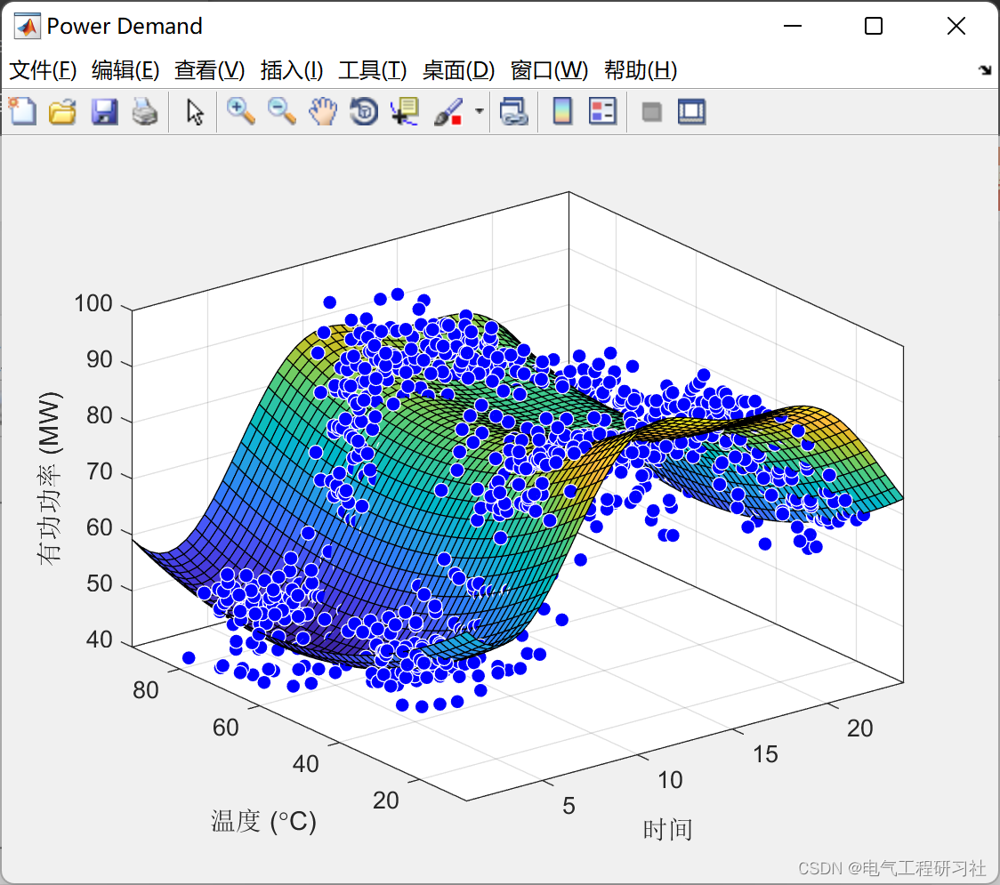
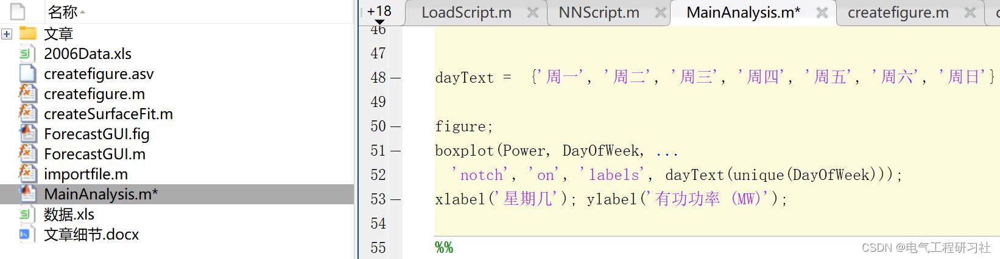

# Long-term and short-term load forecasting (Matlab code implementation)

​  
1. Load Forecasting: Electricity load, also known as "electrical load," refers to the total sum of electrical power consumed by electrical appliance users at a given moment from the power system. The essence of electricity load forecasting is to make preliminary estimates and speculations about future moments or periods based on known conditions of the power system, economy, society, and meteorological data, according to historical load change patterns. Load forecasting affects the management and operation of the power system, serving as an important basis for formulating power generation plans, trading plans, and dispatching plans. There are many criteria for classifying electricity load forecasting, with time cycles being one of the most common. Electricity load forecasting can be divided into short-term forecasting, medium-term forecasting, and long-term forecasting categories based on their prediction timeframes. Short-term forecasting spans from a few seconds or minutes to several hours, medium-term forecasting ranges from hours to weeks, while long-term forecasting extends from months to years. Among these, short-term and medium-term forecasting can be categorized as short-term predictions, while long-term forecasting and medium-term forecasting are collectively referred to as medium-to-long term forecasting. The preprocessing of electricity load data and the selection of forecasting methods are key steps in the task of electricity load forecasting. Before conducting electricity load forecasting, it is necessary to preprocess the load data to minimize the impact of abnormal historical data on prediction accuracy; the choice of forecasting methods and the establishment of predictive models directly affect whether the forecast results achieve ideal accuracy, thereby affecting the entire operation of the power system, making them extremely important.
2 Short-term Power Load Forecasting Methods
Short-term load forecasting, as one of the foundational tasks in power system operation and control, has significant impacts on power dispatching and motor starting/stopping. Traditional short-term power load forecasting methods include time series and regression analysis. Time series forecasting is the earliest research in load forecasting, which models the power load by fitting historical load data curves. This method observes continuous load changes with low time complexity and is widely applied. However, it does not limit the input data requirements and only considers temporal elements without incorporating other factors that may have potential impacts on the results, resulting in low accuracy. Subsequent peak modeling incorporates humidity among other factors. Regression analysis predicts future based on internal data patterns, primarily focusing on the correlation between phenomena. Starting from causality, it can be categorized into univariate or multivariate regression analysis depending on the number of independent variables; from the characteristics of the function expression, it can be divided into linear regression prediction models and nonlinear regression prediction models. The principle of regression analysis is simple and computationally fast, but its ability to capture load influence factors is limited, making the results less accurate, requiring high data input, and heavily dependent on the accuracy of the model and influencing factors.
3. Medium and Long-term Electricity Load Forecasting Methods
Compared to short-term power load forecasting, medium and long-term power load forecasting has a longer prediction period and more influencing factors, making it difficult to ensure the accuracy of predictions. Therefore, compared to short-term power load forecasting methods, there is less research on medium and long-term power load forecasting methods.
The predictive method based on artificial neural networks was first proposed. The Linearly Suppressed Support Vector Machine (LSSVM) uses the Radial Basis Function (RBF) neural network as a kernel function, demonstrating that the predicted data obtained by LSSVM is essentially close to the actual data, with a smaller mean square error compared to both gray prediction methods and artificial neural network prediction methods. To address medium and long-term power load forecasting issues, a tree model combined with a deep neural network called XGBoost-DNN is introduced. It first obtains cross-features, treating the feature vector as the input layer of the DNN. Subsequently, it performs feature processing on time and load data, enabling the DNN model to access higher-order cross-features. This approach enables the prediction of future one-month power load data, showing outstanding performance in simulation experiments with real power data.
Huang Yuansheng et al. [⒃l combined Gaussian Process with Particle Swarm Optimization to construct a hybrid power demand forecasting model. Initially, the covariance function parameters were optimized using the Particle Swarm Optimization algorithm and used as initial values for training the Gaussian Process model in power demand prediction; subsequently, the parameters of the covariance function were further optimized, and the trained Gaussian Process model was employed for medium-to-long-term power load forecasting. This model demonstrated excellent performance in the Beijing area's medium-to-long-term power demand data set.
4 Long-term and short-term load forecasting operational results
Editor
Editor
Editor
Editor
Editor
5. Matlab code: This article only displays a part of the code, the full code can be found in:
Editor
6. References [1] Chen Wei, Zhao Yutong. Residential Electricity Load Forecast Based on Deep Conditional Probability Density Function [J]. Power Grid and Clean Energy, 2022, 38(05): 36-41.
[2] Jin Lili. A Power Load Forecasting Method Based on GRA-SSA-BP Neural Network [J]. Hongshui River, 2022, 41(03):92-96.
[3] Zhu Shiqi. Application of Deep Learning in Electricity Load Forecasting [J]. Industrial and Technology Forum, 2022, 21(14): 42-44.
​  

## Images

<!-- PAYMENT_BLOCK -->

## Get this dataset

- Payment link (Stripe): [Buy now](https://buy.stripe.com/3cs8yP7sY87d0vu9AB)
- Payment QR code: 

<!-- /PAYMENT_BLOCK -->
